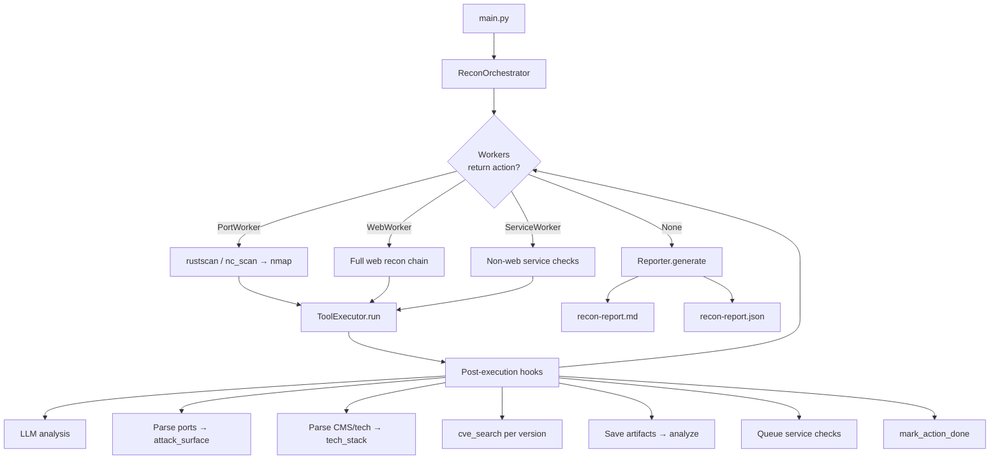
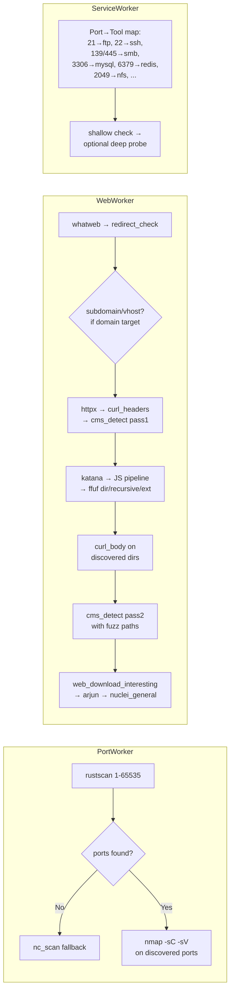

# AI Recon Agent

Autonomous CTF/lab reconnaissance agent — worker-driven, tool-augmented, LLM-assisted for analysis only.

```text
ai-recon-agent/
├── agent/
│   ├── main.py                  CLI entry point
│   ├── orchestrator.py          Worker scheduler, tool execution, post hooks
│   ├── executor.py              Tool registry + subprocess runner
│   ├── state.py                 SQLite persistence (7 tables)
│   ├── reporter.py              Markdown + JSON report generator
│   ├── redaction.py             Secret masking helpers
│   ├── artifacts.py             File artifact storage with JSON index
│   ├── cli.py                   Textual TUI + console UI adapter
│   ├── workers/
│   │   ├── __init__.py          Worker package
│   │   ├── base.py              WorkerAction dataclass + ReconWorker base
│   │   ├── port.py              Port discovery worker
│   │   ├── web.py               Web recon worker
│   │   ├── service.py           Non-web service check worker
│   │   └── report.py            Report placeholder worker
│   └── skills/
│       └── boot2root-recon/
│           ├── SKILL.md
│           └── scripts/
│               ├── register_tools.py   55 tool builders + parsers
│               ├── cms_detect.py       CMS/framework detector
│               ├── cve_search.py       Generic searchsploit wrapper
│               ├── artifact_analyze.py Local file analyzer
│               ├── service_check.py    Service scanner (FTP/SMB/SSH/...)
│               ├── ftp_deep.py         FTP downloader
│               ├── smb_deep.py         SMB share lister
│               ├── web_download_interesting.py
│               ├── {dns,ftp,ldap,mssql,mysql,nfs,redis,smb,smtp,snmp,ssh,vnc}.py
│               └── ...
├── config/
│   ├── settings.yaml            Runtime config (LLM models, timeouts)
│   └── scope.yaml               Scope policy — NOT ENFORCED yet
├── data/                        Fallback wordlists
├── docs/
│   ├── WORKFLOW.md              Current runtime workflow reference
│   ├── ARCHITECTURE-WORKFLOW.md
│   ├── decision-tree.md         Full decision tree diagrams
│   ├── skills-reference.md
│   └── SETUP.md
├── benchmarks/
│   └── MANUAL-BENCHMARK-GUIDE.md
├── outputs/                     Session DB, logs, artifacts, reports
├── AGENT.md                     System prompt / behavior rules
├── RTK.md                       RTK token-savings usage notes
├── requirements.txt
├── .env.example
└── README.md
```

---

## Quick Start

```bash
cp .env.example .env   # add SHINE_API_KEY
pip install -r requirements.txt
AI_RECON_TUI=0 python3 agent/main.py --target scanme.nmap.org --max-steps 25 --verbose
```

### Flags

| Flag | Default | Description |
|------|---------|-------------|
| `--target` | — | Single target (domain/IP/URL) |
| `--targets` | — | File with targets (one per line) |
| `--max-steps` | 50 | Max tool execution cycles |
| `--passive-only` | false | Skip active scanning |
| `--no-service` | false | Skip non-web service checks |
| `--resume` | — | Resume existing session ID |
| `--verbose` / `-v` | false | Show parsed tool output |
| `--threads` | 1 | Parallel targets (parsed only, not wired) |
| `--output` | — | Output dir override (parsed only, not wired) |

### Examples

```bash
# Basic scan
python agent/main.py --target scanme.nmap.org

# CTF target with full depth
python agent/main.py --target 10.10.10.42 --max-steps 100 --verbose

# Passive only (whois/dig/crt_sh)
python agent/main.py --target example.com --passive-only

# Resume interrupted session
python agent/main.py --target 10.10.10.42 --resume abc123def456

# Multiple targets (sequential)
python agent/main.py --targets targets.txt
```

---

## Architecture

### Core Loop



### Worker Decision Flow



### Post-Execution Hook Chain

Every tool execution triggers this sequence:

```mermaid
flowchart LR
    R[ToolExecutor result] --> A1[LLM analysis]
    A1 --> A2[Save finding to SQLite]
    A2 --> A3[Parse ports →\nadd_surface_item]
    A3 --> A4[Parse artifacts →\nsave + add_finding]
    A4 --> A5[artifact_analyze\nif suspicious]
    A5 --> A6[Parse CMS/framework\n→ tech_stack + finding]
    A6 --> A7[cve_search if\nversion has digits]
    A7 --> A8[Queue service checks\nfor new ports]
    A8 --> A9[mark_action_done\nfor exact dedup]
```



---

## Output Structure

```
outputs/{target}/
├── recon.db                 SQLite state (findings, tech, surface, artifacts)
├── recon-report.md          Markdown report (human-readable)
├── recon-report.json        JSON report (machine-parseable)
├── live-activity.log        Timestamped activity log
└── artifacts/
    ├── index.json            Master artifact index
    ├── flag/                 Flag/proof artifacts
    ├── credential/           Credential artifacts
    ├── config/               Config artifacts
    ├── database/             Database artifacts
    └── artifact/             Other interesting artifacts
```

---

## Tool Registry (55 tools)

### Passive (7)

| Tool | Description |
|------|-------------|
| `whois` | Domain registration lookup |
| `dig` | DNS record queries |
| `crt_sh` | Certificate transparency log search |
| `subfinder` | Subdomain enumeration |
| `gau` | URL gathering (wayback) |
| `dnsx` | Multi-type DNS resolution |
| `theHarvester` | Email/subdomain/host gathering |

### Active Surface (9)

| Tool | Description |
|------|-------------|
| `rustscan` | Full TCP port sweep (1-65535) |
| `nc_scan` | Netcat fallback port scan |
| `nmap` | `-sC -sV` on discovered ports only |
| `masscan` | High-speed port scan (unused currently) |
| `whatweb` | Web fingerprinting |
| `httpx` | HTTP probe (title, status, tech) |
| `ffuf_dir` | Directory fuzzing (wordlist selectable) |
| `ffuf_recursive` | Recursive directory fuzzing |
| `ffuf_ext` | Extension-based file fuzzing |

### Service Checks (12)

| Tool | Port(s) |
|------|---------|
| `ftp_check` | 21 |
| `ssh_check` | 22 |
| `smtp_check` | 25, 465, 587 |
| `dns_check` | 53 |
| `snmp_check` | 161 (not registered yet) |
| `smb_check` | 139, 445 |
| `ldap_check` | 389, 636 |
| `mssql_check` | 1433 |
| `nfs_check` | 2049 |
| `mysql_check` | 3306 |
| `redis_check` | 6379 |
| `vnc_check` | 5900, 5901 |

### Web Expansion (27)

| Tool | Purpose |
|------|---------|
| `katana` | Crawler/spider |
| `js_dump` | Download JS files |
| `js_deobfuscate` | Deobfuscate JS |
| `js_mine` | Mine JS for secrets/endpoints |
| `jsluice` | JS analysis |
| `arjun` | Parameter discovery |
| `kiterunner` | Route brute-force |
| `graphw00f` | GraphQL fingerprint |
| `s3scanner` | S3 bucket discovery |
| `shodan` | Shodan search |
| `trufflehog` | Secret scanning |
| `corsy` | CORS misconfiguration |
| `nuclei_general` | Template-based vuln scanning |
| `nuclei_tech` | Tech-specific templates |
| `testssl` | TLS testing |
| `curl_headers` | HTTP response headers |
| `curl_body` | HTTP response body |
| `redirect_check` | Follow redirects |
| `hosts_add` | Add hosts entry |
| `cms_detect` | CMS/framework detection |
| `cve_search` | Generic searchsploit lookup |
| `artifact_analyze` | Local file suspicious text scan |
| `web_download_interesting` | Download sensitive URLs |
| `ftp_deep` | FTP download |
| `smb_deep` | SMB share download |
| `redis_deep` | Redis info/keys/values dump |
| `ffuf_vhost` | Virtual host discovery |

---

## Config

### `config/settings.yaml`

```yaml
general:
  name: ai-recon-agent
  version: 0.1.0

executor:
  default_timeout: 120
  max_output_chars: 5000
  delay_between_tools_ms: 500
  retry_on_error: true
  max_retries: 2

orchestrator:
  max_steps_default: 100
  recent_findings_in_context: 5
  model_decision: codex/gpt5.5        # LLM (legacy, unused)
  model_analysis: codex/gpt-5.4-mini  # LLM for analysis
  temperature_decision: 0.0
  temperature_analysis: 0.0
  temperature_report: 0.3

state:
  db_path: outputs/{target}/recon.db

reporter:
  output_dir: outputs/{target}/
```

### `.env`

```bash
SHINE_API_KEY=sk-...
SHINE_BASE_URL=https://api.shineshop.dev/v1
```

---

## Dedup Strategy

Two-layer dedup prevents redundant work:

1. **Tool-name check** (`_used_tools` / `self.used`) — legacy, gates most worker stages by simple tool name set.
2. **Exact-action check** (`action_done`) — for tools that run multiple times with different targets/params:
   - `cms_detect` pass 1 vs pass 2 (different `paths` param)
   - `curl_body` on multiple discovered directory URLs
   - `artifact_analyze` per saved artifact file
   - `cve_search` per tech+version combination

Key format: `"{tool}|{target}|{sorted_params_json}"`

---

## Known Limitations

| Issue | Status |
|-------|--------|
| `ServiceWorker.PORT_TO_CHECK` references unregistered tools | `rdp_check`, `postgres_check`, `mongo_check` not registered |
| `snmp_check` not mapped for port 161 | Missing in `PORT_TO_CHECK` |
| Multi-web-target scheduling | Only handles `web_targets[0]` |
| `--threads` / `--output` CLI flags | Parsed but not wired |
| `scope.yaml` not enforced | No runtime scope filtering |
| Stale `_llm_decision` / `_build_decision_prompt` code in orchestrator | Unused, preserved as reference |
| `generate_report` branch in `run()` | Legacy guard, workers always drive now |

---

## Benchmark
...........

---

## Design Principles

1. **Code is truth** — docs/learning/skills derive from actual runtime behavior.
2. **Deterministic workers** — tool selection is hardcoded in workers, not LLM.
3. **LLM is analysis-only** — describes what tool output means, does not choose tools.
4. **Generic CVE lookup** — `cve_search` uses `searchsploit --json`; no hardcoded CVE/writeup logic.
5. **Exact-action dedup** — prevents false skips when tools run multiple times.
6. **Fuzz → curl_body → CMS** — directory listings found by fuzz are body-fetched before CMS follow-up.
7. **Redaction is best-effort** — raw artifacts may contain secrets, but DB/UI/report are masked.
